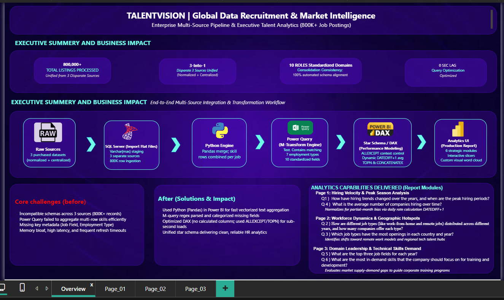
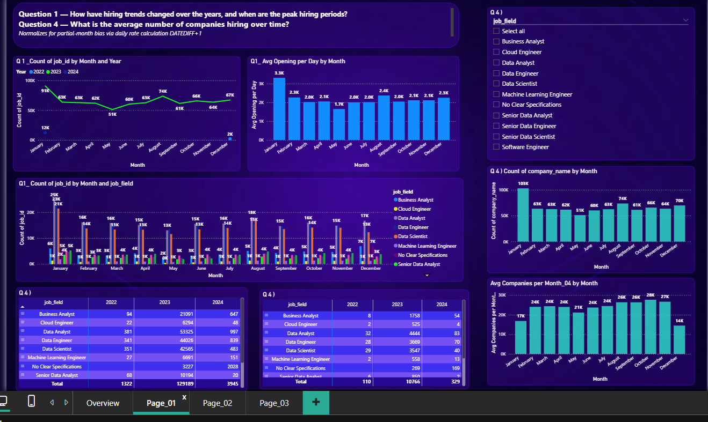
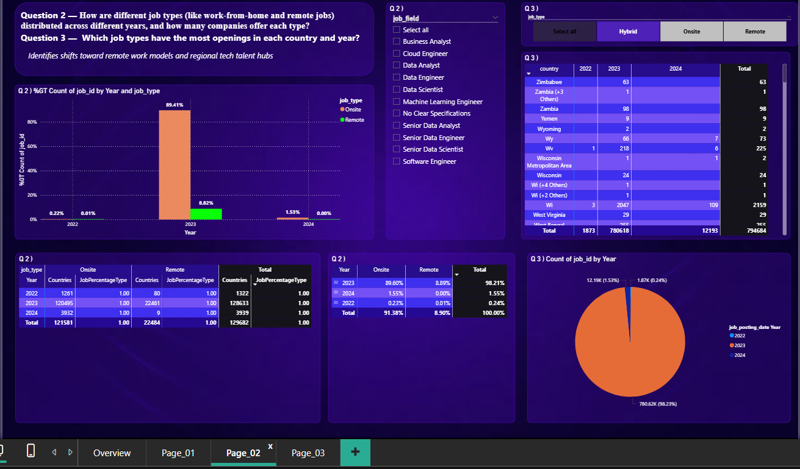
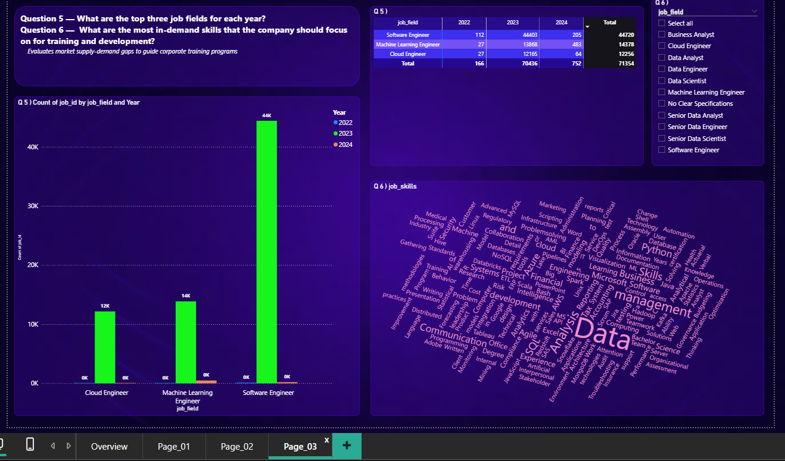

# Job Market Analytics & Database Consolidation Solution

> An end-to-end data engineering and Power BI solution that transforms fragmented, multi-source recruitment data into a unified, high-performance analytics database — delivering actionable hiring insights for a recruitment and selection firm.

---

## 📋 Table of Contents

- [Project Summary](#-project-summary)
- [Problem Statement](#-problem-statement)
- [Solution Overview](#-solution-overview)
- [Tools & Technologies](#-tools--technologies)
- [Key Contributions](#-key-contributions)
- [Challenges Faced](#-challenges-faced)
- [Solutions Implemented](#-solutions-implemented)
- [Impact](#-impact)
- [Project Architecture](#-project-architecture)
- [Dashboard Preview](#-dashboard-preview)
- [Repository Structure](#-repository-structure)
- [Links](#-links)
- [Key Takeaways](#-key-takeaways)

---

## 📌 Project Summary

A recruitment and selection firm acquired a **large volume of job-market data** from multiple sources — some normalised, some centralised — in response to a surge in data-field job inquiries. The data was highly disorganised, filled with inconsistencies and missing values, with critical details buried inside **lengthy unstructured paragraphs**. It consisted of **multiple fragmented, disconnected tables** with no relationships, and the database was **extremely large (7 lakh+ rows)**.

This project delivers an **end-to-end data engineering and analytics solution** that:

- ✅ Consolidates fragmented multi-source tables into a **proper database** for the in-house team's future use
- ✅ Extracts structured fields from **unstructured paragraphs**
- ✅ Merges everything into a **single comprehensive Power BI table** per the client's schema
- ✅ **Optimises the report** for 7 lakh+ rows without compromising speed
- ✅ Delivers an interactive dashboard answering **6 business questions**

---

## ❗ Problem Statement

- **Data inconsistencies and missing information:** The database was filled with inconsistencies and missing values, making it unreliable.
- **Unstructured content:** Critical details were embedded within lengthy, unstructured paragraphs, complicating extraction.
- **Fragmented and disconnected tables:** Multiple poorly structured, distorted, and fragmented tables with no connections — isolated data silos.
- **Extreme data volume:** 7 lakh+ rows made efficient processing difficult.
- **Mixed source formats:** Some sources provided normalised data, others centralised — requiring harmonisation.
- **Report optimisation:** The final Power BI report had to be fully optimised for speed and accuracy.
- **Future-proofing:** The client required a proper database since the **in-house team will use it going forward**.

---

## 💡 Solution Overview

1. **Database Formation** — Multiple source tables consolidated into a structured database with proper relationships, serving as the single source of truth
2. **Data Extraction & Cleansing** — Structured fields extracted from unstructured paragraphs; inconsistencies and missing values handled
3. **Schema Consolidation** — All tables merged into a single comprehensive Power BI table following the client's schema
4. **Performance Optimisation** — Report optimised for 7 lakh+ rows with efficient modelling
5. **Interactive Dashboard** — Insights on hiring trends, job type distribution, top job fields, and in-demand skills

---

## 🛠 Tools & Technologies

| Tool | Purpose | Why This Tool? |
|------|---------|----------------|
| **Power Query (M Language)** | Extract from unstructured paragraphs, clean inconsistencies, merge fragmented tables | Load-time transformations handle 7 lakh+ rows efficiently; repeatable and documented |
| **Power BI** | Consolidate into single table per schema; build interactive dashboard | Industry-standard BI tool; handles large data with proper optimisation |
| **DAX** | Dynamic measures for trends, top-N analysis, year-over-year comparisons | Dynamic aggregation recalculates based on filter context |
| **Data Modelling** | Establish relationships between source tables before consolidation | Eliminates isolated data silos |
| **Text Extraction** | Parse lengthy paragraphs to extract skills, summaries, and other fields | Transforms free-text into structured, analysable data |

### Why This Tool Stack?

- **Scale-first:** Power Query handles 7 lakh+ rows at load time far better than row-by-row DAX
- **Single source of truth:** Forming a proper database first gives the in-house team a reliable foundation
- **Performance-optimised:** Careful modelling and data typing keep the report fast despite volume
- **Extraction at source:** Paragraph parsing done during ETL so the model only contains clean data

---

## 🚀 Key Contributions

### 3.1 Database Formation from Fragmented Sources

- Consolidated multiple fragmented, poorly structured, disconnected source tables into a **proper database** with defined tables and relationships
- Harmonised mixed source formats — normalised and centralised data unified
- Established connections between previously isolated data silos
- Created a reusable database foundation for the in-house team's future use

### 3.2 Data Extraction from Unstructured Content

- Extracted critical structured details embedded within **lengthy unstructured paragraphs** (job skills, summaries, and more)
- Handled **inconsistencies and missing values** across all source tables
- Standardised formats for dates, job levels, and employment types
- Applied rule-based cleaning in Power Query for repeatability

### 3.3 Schema Consolidation in Power BI

- Merged all database tables into a **single comprehensive table** adhering exactly to the client's schema: Job_id, Job title, Job_field, Company name, Job_location, Job_posting_date, Job_level, Job_type, Job_skills, Job_employment_type, Summary
- Ensured correct data types and business meanings per the client's definitions
- Delivered a clean, analysable model ready for reporting

### 3.4 Performance Optimisation at Scale

- Designed the report to handle **7 lakh+ rows** without compromising speed or performance
- Chose load-time Power Query transformations over row-by-row DAX calculated columns
- Applied appropriate data typing and modelling best practices

### 3.5 Dashboard Delivery — 6 Business Questions

- **Q1 — Hiring trends over the years:** Visual analysis of job openings over time to identify peak hiring periods
- **Q2 — Job type distribution across years:** Analysis of job types (WFO, remote, on-site, hybrid) across years, including number of companies offering each and contribution to total jobs
- **Q3 — Dominant job types by country and year:** Identification of which job types have the highest openings per country and year
- **Q4 — Average number of companies hiring over time:** Trend analysis to gauge market activity and stability
- **Q5 — Top three job fields per year:** Most in-demand sectors annually to align recruitment strategies
- **Q6 — Most in-demand skills:** Visualisation to guide training and development initiatives

---

## ⚠️ Challenges Faced

- **Data inconsistencies and missing information** made the data unreliable
- **Unstructured paragraphs** buried critical details, complicating extraction
- **Fragmented, disconnected tables** with no relationships created isolated data silos
- **Extreme volume (7 lakh+ rows)** made efficient processing difficult
- **Mixed source formats** (normalised vs. centralised) required harmonisation
- **Report optimisation pressure** — the final report had to be fast and accurate at scale
- **Future-proofing requirement** — the database had to be maintainable for the in-house team, not just a one-off dashboard

---

## ✅ Solutions Implemented

- **Database formation:** Fragmented source tables consolidated into a proper database with defined tables and relationships, harmonising normalised and centralised sources
- **Unstructured data extraction:** Power Query (M Language) parsed lengthy paragraphs to extract structured fields like job skills and summaries
- **Inconsistency handling:** Rule-based cleaning standardised formats, handled missing values, and ensured consistency — repeatable and documented
- **Schema consolidation:** All tables merged into a single Power BI table following the client's exact schema with correct data types
- **Performance optimisation:** Load-time Power Query transformations chosen over DAX calculated columns; data typing and modelling best practices applied for 7 lakh+ rows
- **DAX measures:** Dynamic measures for hiring trends, job type distribution, top-N job fields per year, average companies hiring, and in-demand skills
- **Dashboard delivery:** Interactive dashboard answering all 6 business questions with clear visuals

---

## 📈 Impact

| Area | Before | After |
|------|--------|-------|
| **Data structure** | Fragmented, disconnected tables with isolated silos | Proper database with defined tables and relationships |
| **Source harmonisation** | Mixed normalised and centralised formats | Unified, consistent database foundation |
| **Unstructured content** | Critical details buried in lengthy paragraphs | Structured, analysable fields extracted via Power Query |
| **Data quality** | Inconsistencies and missing values | Rule-based cleaning, standardised and repeatable |
| **Consolidation** | No single comprehensive table | Single Power BI table adhering to client schema |
| **Performance** | 7 lakh+ rows difficult to process | Optimised report handling full volume without compromising speed |
| **Future usability** | No reliable database for in-house team | Maintainable, well-structured database as single source of truth |
| **Client insight** | No visibility into hiring trends or skill demand | Interactive dashboard answering 6 business questions |

---

## 🏗 Project Architecture

```
┌─────────────────┐     ┌─────────────────┐     ┌─────────────────┐
│  Source 1       │     │  Source 2       │     │  Source N       │
│  (Normalised)   │     │  (Centralised)  │     │  (Mixed)        │
└────────┬────────┘     └────────┬────────┘     └────────┬────────┘
         │                       │                       │
         └───────────────────────┼───────────────────────┘
                                 ▼
                    ┌─────────────────────────┐
                    │  Database Formation     │
                    │  (Tables + Relationships)│
                    │  Single Source of Truth │
                    └────────────┬────────────┘
                                 │
                                 ▼
                    ┌─────────────────────────┐
                    │  Power Query (M)        │
                    │  • Extract from         │
                    │    unstructured text    │
                    │  • Clean inconsistencies│
                    │  • Handle missing values│
                    │  • Standardise formats  │
                    └────────────┬────────────┘
                                 │
                                 ▼
                    ┌─────────────────────────┐
                    │  Consolidated Table     │
                    │  (Client Schema)        │
                    │  7 lakh+ rows           │
                    └────────────┬────────────┘
                                 │
                                 ▼
                    ┌─────────────────────────┐
                    │  Power BI + DAX         │
                    │  • Trends over years    │
                    │  • Job type distribution│
                    │  • Top-N fields         │
                    │  • In-demand skills     │
                    │  • Performance optimised│
                    └────────────┬────────────┘
                                 │
                                 ▼
                    ┌─────────────────────────┐
                    │  Recruitment Firm       │
                    │  Client Dashboard       │
                    └─────────────────────────┘
```

---

## 🖼 Dashboard Preview









---

## 📁 Repository Structure

```
job_analysis_pipeline_powerbi_26/
├── 📂 assets/
│   ├── job_analysis_overview.png
│   ├── job_analysis_page_01.png
│   ├── job_analysis_page_02.png
│   └── job_analysis_page_03.png
│
├── 📂 dashboard/
│   └── Job_Analysis.pbix
│
├── 📂 data/
│
├── 📂 src/
│   ├── 📂 dax/
│   │   ├── Average_Opening.dax
│   │   └── Avg_Companies_per_Month.dax
│   │
│   ├── 📂 power_query/
│   │   ├── complte_power_query_code.m
│   │   ├── job_analysis.m
│   │   ├── job_analysis_power_query_step_01.png
│   │   ├── job_analysis_power_query_step_02.png
│   │   ├── job_tittle.m
│   │   ├── replace_ttittle.m
│   │   └── summery.m
│   │
│   └── 📂 python/
│       └── job_analysis.ipynb
│
├── .gitattributes
├── .gitignore
├── README.md
└── job_analysis_project.docx
```

---

## 🔗 Links

| Resource | Link |
|----------|------|
| 📊 **Power BI Dashboard** | [Power BI Dashboard](https://app.powerbi.com/links/yWFT55rg1j?ctid=95cd5fc7-eedf-4dcd-8986-48528f05d39f&pbi_source=linkShare) |
| 📁 **Dataset** |[Dataset ](data)  |
| 📝 **Project Notes (DAX/Power Query)** | [DAX/Power Query](src)  |

---

## 🎯 Key Takeaways

- Consolidated **multiple fragmented, multi-source recruitment tables** (normalised and centralised) into a **proper database** serving as the single source of truth for the in-house team
- Extracted structured fields from **lengthy unstructured paragraphs** using Power Query (M Language)
- Handled **inconsistencies and missing values** with rule-based, repeatable cleaning
- Merged everything into a **single comprehensive Power BI table** adhering to the client's required schema
- **Optimised the report for 7 lakh+ rows** by choosing load-time transformations over row-by-row DAX
- Delivered an **interactive dashboard answering 6 business questions** on hiring trends, job type distribution, top job fields, and most in-demand skills

---

## 🏃‍♂️ How to Run

1. **Clone the repository:**
   ```bash
   git clone https://github.com/your-username/job_analysis_pipeline_powerbi_26.git
   ```

2. **Prepare the data:**
   - Place source files in `data/raw/` (sanitized samples provided)
   - Review `database/schema_reference.md` for the target schema

3. **Open Power BI:**
   - Open `power_bi/Job_Analysis.pbix`
   - Refresh data connections
   - Review Power Query transformations in `power_query/m_code_reference.md`
   - Explore the interactive dashboard

4. **Review documentation:**
   - `docs/project_notes.md` for detailed notes
   - `power_bi/dax_measures.md` for all DAX measures

---

## 📄 License

This project is for portfolio and educational purposes. Dataset has been sanitized to remove any sensitive information.

---

## 🙏 Acknowledgments

- Recruitment and selection firm client for the business context and requirements
- In-house team for future database usage requirements
- Power BI community for DAX and performance optimisation best practices

---

<div align="center">

**⭐ If you found this project helpful, please give it a star! ⭐**

</div>

---

